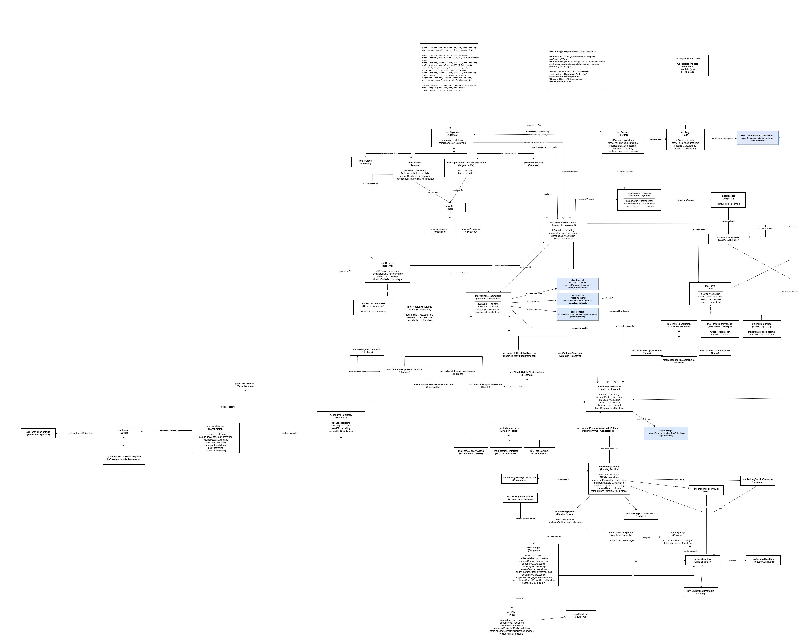

# Diagramas del modelo conceptual

## Finalidad
Esta carpeta reúne las **representaciones gráficas de la ontología de movilidad urbana compartida**, utilizadas durante su conceptualización, diseño y documentación.

## Esquema general de la ontología
El diagrama general recoge las clases, jerarquías, propiedades y relaciones del modelo, incluyendo vehículos compartidos, agentes y roles, servicios y trayectos, reservas, tarifas, facturas y pagos.

Archivo previsto: `ontologia_movilidad_compartida.png` (exportación recortada y centrada, pendiente de incorporar a esta carpeta).

Una vez incorporado el archivo, puede visualizarse mediante:

```markdown

```

## Contenido
- Diagramas de clases, jerarquías, propiedades y relaciones.
- Representaciones de patrones ontológicos utilizados en la práctica.
- Archivos editables (`.drawio`, `.xml`) y exportaciones (`.svg`, `.png`, `.pdf`).

## Mantenimiento
Los diagramas deben mantenerse alineados con la implementación de [`../ontologia/`](../ontologia/). Esta carpeta documenta visualmente el modelo, pero no sustituye al código RDF/OWL de la ontología.
